# Docs Panel

A VS Code extension that shows one folder of the workspace (`docs` by default) in a
single webview tab: a file tree and a contents list on the left, the selected file
rendered on the right. Both sides follow changes made on disk. Files can be tagged,
coloured, pinned, grouped into tag buckets, searched by text or by tag, edited and
trashed from the panel.

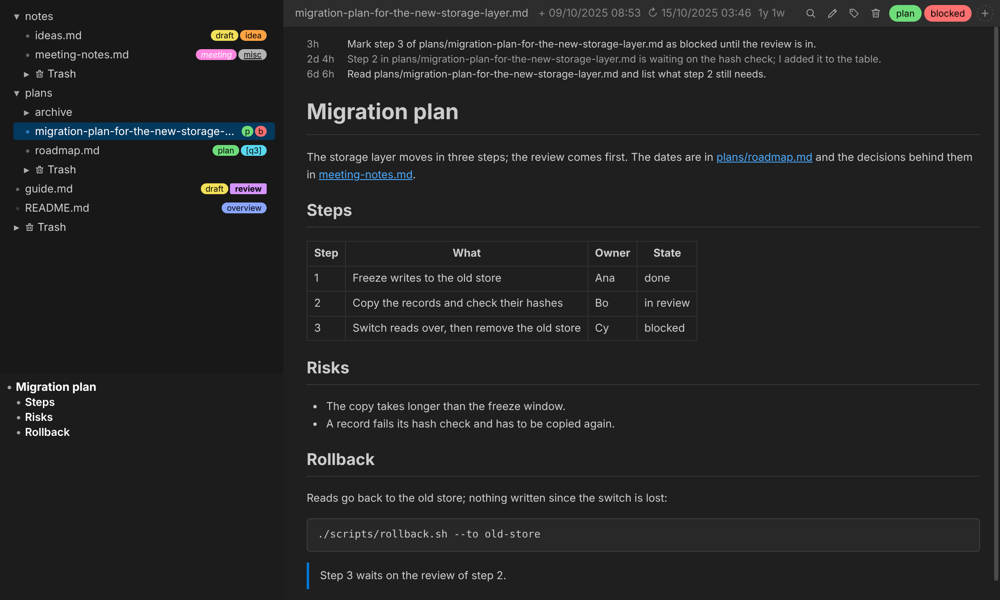

- [Requirements](#requirements)
- [Install](#install)
- [Layout](#layout)
- [Tree](#tree)
- [Page](#page)
- [Tags](#tags)
- [Tag buckets](#tag-buckets)
- [Tables](#tables)
- [Referenced by](#referenced-by)
- [Search all docs](#search-all-docs)
- [Mentions from Claude Code sessions](#mentions-from-claude-code-sessions)
- [Options](#options)
- [Settings](#settings)
- [Files the panel writes](#files-the-panel-writes)
- [Source layout](#source-layout)
- [Development](#development)
- [Screenshots](#screenshots)
- [Releasing](#releasing)
- [Limits](#limits)

## Requirements

- VS Code 1.90 or later.
- The built-in `vscode.markdown-language-features` extension, which renders Markdown.

## Install

From a release: download `docs-panel-<version>.vsix` from the
[releases page](https://github.com/sebuju/docs-panel/releases) and install it:

```sh
code --install-extension docs-panel-<version>.vsix
```

From source:

```sh
npm install
npm run package          # writes docs-panel-<version>.vsix
code --install-extension docs-panel-<version>.vsix
```

Open the panel with **Docs Panel: Open** (`docsPanel.open`) from the command palette. The
tab is restored with the window.

## Layout

| Part | Contents |
|---|---|
| Tree | The docs folder. Folders first, sorted by name, then files, most recently modified first. Dot-files, dot-folders and `node_modules` are not shown; folders deeper than 12 levels are cut off. |
| Contents list | The headings of the open Markdown file. The entries whose sections are on screen are highlighted; a click scrolls to the heading. |
| File bar | File name, created and modified time, age, and buttons for find, edit, tags and trash, followed by the file's tags and `+` to add one. Clicking the file name copies its path relative to the workspace (see `docsPanel.copyPrefix`). |
| Page | The rendered file. |

How each file type is shown:

| Extension | Shown as |
|---|---|
| `.md`, `.markdown` | Rendered by VS Code's Markdown renderer |
| `.html`, `.htm` | The document's `<body>`, with scripts and styles removed and relative links resolved |
| `.png`, `.jpg`, `.jpeg`, `.gif`, `.svg`, `.webp` | Image |
| anything else | Plain text |

Each file reopens at the scroll position it was left at, stored as a fraction of the
page height so it stays close after edits.

The dot in front of a file in the tree shows its read state: unread, read, or unread and
mentioned in a Claude Code session (see [Mentions](#mentions-from-claude-code-sessions)).
A file is marked read when opened, and unread again when it changes on disk while not open.

The panel also works in a light theme:

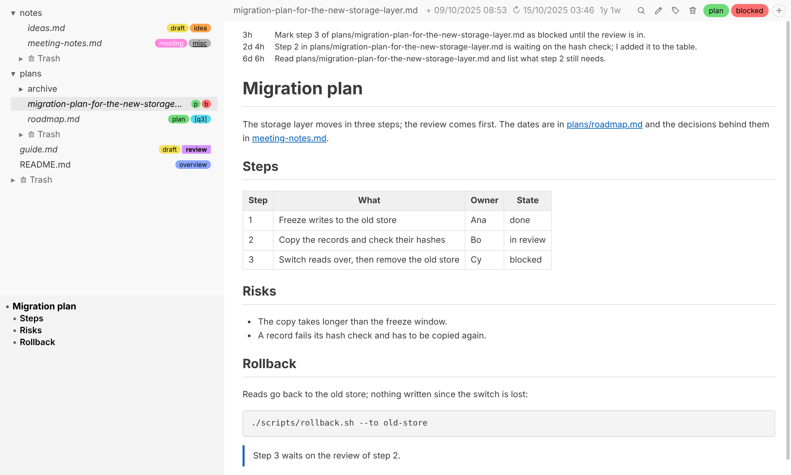

## Tree

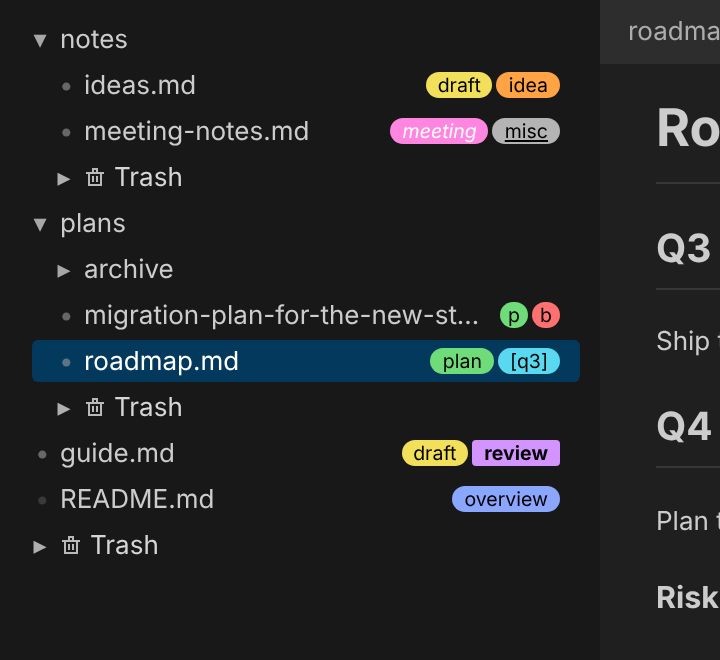

When a row is too narrow for its tags' names, the tags are drawn with their letters:

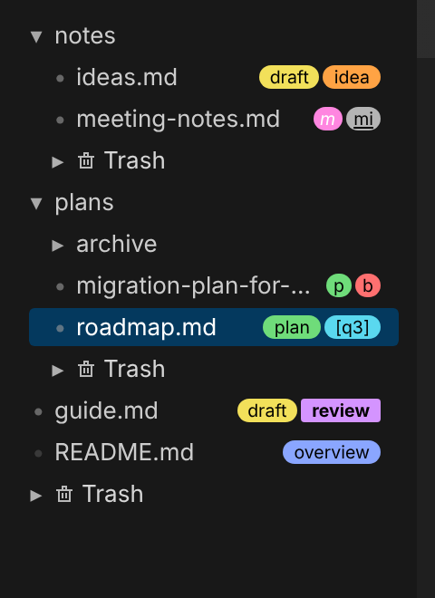

Right click a row, or press `Space`, `Shift+F10` or the menu key on it, for its menu:

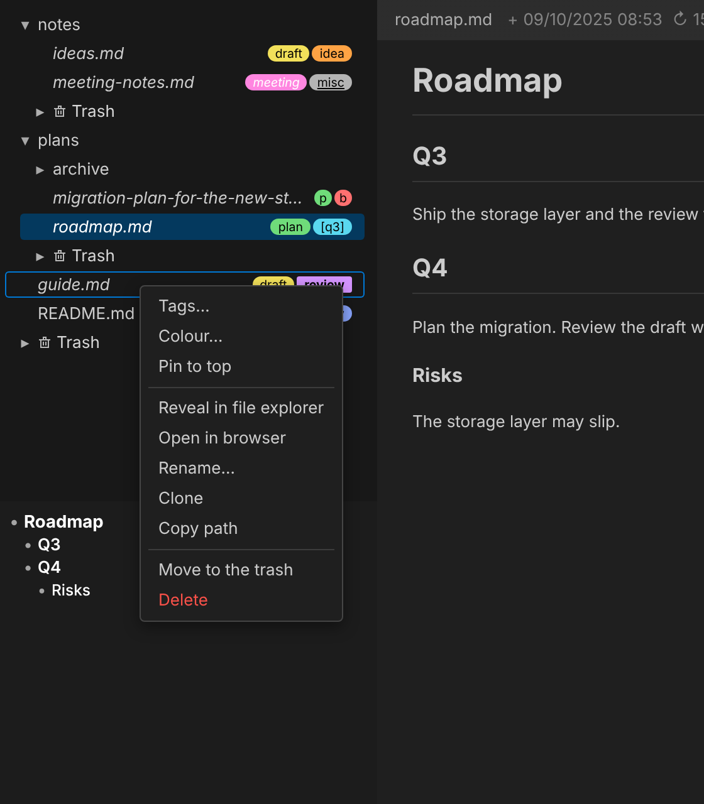

| Action | How |
|---|---|
| Open a file | Click it |
| Tag a file | `Ctrl`+click it, **Tags…** in its menu, or `+` in the file bar |
| Colour a file or folder | **Colour…** in its menu. Colours come from the active theme. |
| Pin a file or folder to the top of its folder | **Pin to top** in its menu. A pinned file shows a pin in place of its dot. |
| Group a folder's files by tag | **Tag buckets…** in the folder's menu; see [Tag buckets](#tag-buckets) |
| Open a file in the system browser | **Open in browser** in its menu |
| New file or folder | **New file…** / **New folder…** in a folder's menu, or in the menu of the empty space under the tree for the docs root |
| Rename, clone, copy path, reveal in the OS file manager | The row's menu |
| Move a file or folder | Drag it onto a folder |
| Trash a file | **Move to the trash** in its menu, or the bin button in the file bar |
| Restore or delete trashed files | Right click a trash folder: **Restore all** or **Delete all**; or an entry's own menu |
| Resize the side | Drag the divider between the side and the page |
| Auto size the side's width | Right click that divider: auto size to the files, auto size growing only, or off. While auto sized the divider cannot be dragged; in grow-only mode a click on it refits the side. |
| Auto size the tree or the contents list | Right click the divider between them: auto size the files, the contents, or neither. The same menu hides the contents list (**Show toc**); the options bring it back. |

Trashed files go to a `.trash` folder next to them. The root's `.trash` is shown at the
foot of the tree, and each folder lists its own `.trash` as **Trash**.

Keys, with the tree focused (click it or `Tab` to it):

| Key | Action |
|---|---|
| `Up` / `Down` | Previous / next row; a file selected this way opens |
| `Right` | Closed folder: open it. Open folder: go to its first entry. Markdown file: move into the page at its first block. Other file: move into the page so `Up` / `Down` scroll it. |
| `Left` | Open folder: close it. Otherwise go to the parent folder. |
| `Space`, `Shift+F10`, menu key | Open the row's menu. `Up` / `Down` select, `Enter` runs, `Escape` closes. |

From the page (while reading, not editing), `Left` returns to the tree at the row that was
left. In a Markdown file, `Right` from there returns to the block that was selected.

## Page

| Action | How |
|---|---|
| Follow a link | Click a Markdown link, or a file name in the text. A file in the docs folder opens in the panel; any other workspace file (for example `src/panel.ts`) opens in an editor. |
| Back / forward | Mouse back and forward buttons walk the history of opened files |
| Zoom an image | Click it. Scroll to zoom, drag to pan, `0` to fit, `Escape` to close. |
| Edit | Pen button in the file bar, then `Ctrl+S` to save. A file left in edit mode reopens in edit mode. |
| Find in the page | `Ctrl+F`, prefilled with the selection. `Up` / `Down` or `Enter` / `Shift+Enter` step through matches. Match case, whole word and regular expression are toggles. |
| Step through blocks | In a Markdown file, `Up` / `Down` highlight the previous / next block and scroll it into view |
| Copy | Right click: **Copy** (selection) or **Copy text block** (the block under the pointer) |
| Find a word | Right click it: **Find “word”** or **Find “word” in all docs** |

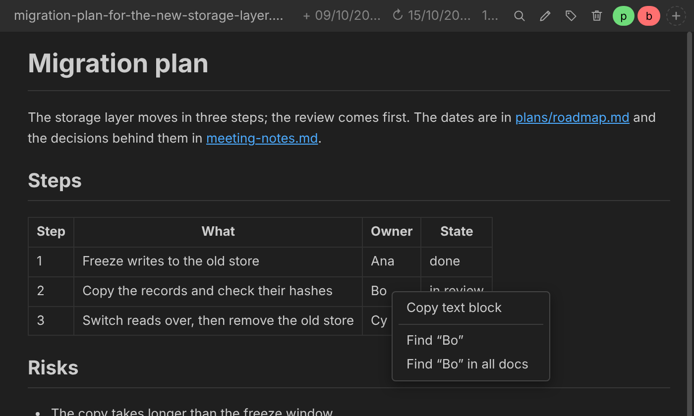

The block under the pointer is highlighted, a list item together with its bullet or
number. Its strength and padding are set in the options; strength `off` disables it.

While a Markdown page scrolls, its headings come up as labels beside the scrollbar: square
on the left, pointed on the right, the point at the height that heading stands at in the
page, so the thumb lies over the ones on screen. The size of a label's text follows the
heading's level. They fade out a moment after the scrolling stops (1200 ms by default), and
stay while the pointer is on one or the thumb is held. The label of the section being read
is lit, and a click on a label scrolls to its heading. No two labels overlap: a higher
heading keeps its place, a lower one is moved out of its way, keeping the page's order, as
far as its point still reaches its spot, and is left out when there is no room there.

The options choose the levels shown (`#`, `##` and `###`, H1 to H3, by default; none turns
the labels off), how long they stay after the scrolling stops (100 to 10000 ms), and how far
the page must scroll in one go before they come up (`any` by default, up to 1000 px). Once
up, any scroll keeps them up.

## Tables

| Action | How |
|---|---|
| Sort by a column | Click its header cell: descending first, then ascending on the next click. The cell under the pointer is highlighted on its own. |
| Sort by more columns | `Shift`+click further header cells; each joins the sort after the ones already in it, and `Shift`+click on one of them turns it the other way. Rows that tie keep their order. |
| Move a row | Hover the row and drag the grip that appears to the left of it. A line shows where it will land; `Escape` cancels. |

Both rewrite the file. Only the order of the table's rows changes: the page sends the
lines the rows are written on and their new order with the text it was drawn from, and
the extension refuses unless the file is still exactly that text, the lines are the body
rows of one table (straight under its delimiter row, with only blank lines between them),
and the result holds the same lines and line breaks with only those rows moved. The page
is then drawn again from the file. A table whose rows cannot be traced to their lines
cannot be sorted or dragged, and nothing is done while the file has unsaved edits.

A sort is a one-off rewrite: nothing about it is saved, and a table edited later is not
sorted again. The header marks the last sort (`▼` descending, `▲` ascending, numbered
when several columns take part) until the file changes.

Numbers are compared by value, other text as words with the numbers in them counted,
ignoring case. Empty cells go last either way.

The options set where text stands in a cell (top, center, bottom) and the header row's
background: a faint grey by default, none, or one of the theme's colours.

## Referenced by

Above the page, the files that name the open file are listed, each as a link with its path,
in a box marked by a bar of the link colour down its left and a faint wash of it behind:
a doc opens in the panel, any other file in an editor. Every one is listed; a file naming
itself is not. A file names another the way a page's names become links (a path from the
file's own folder, a path ending in the name, or a name only one doc has), or by a
relative Markdown or HTML link.

**Referenced by** in the options sets where they are looked for: `docs` (the default),
`all files` in the workspace (except `node_modules`, `.git`, trash folders and the
panel's own data files), or `off`. Each file is read once for the names in it and read
again only when it changes; the results are cached in `.vscode/docs-panel-refs.json`.

## Tags

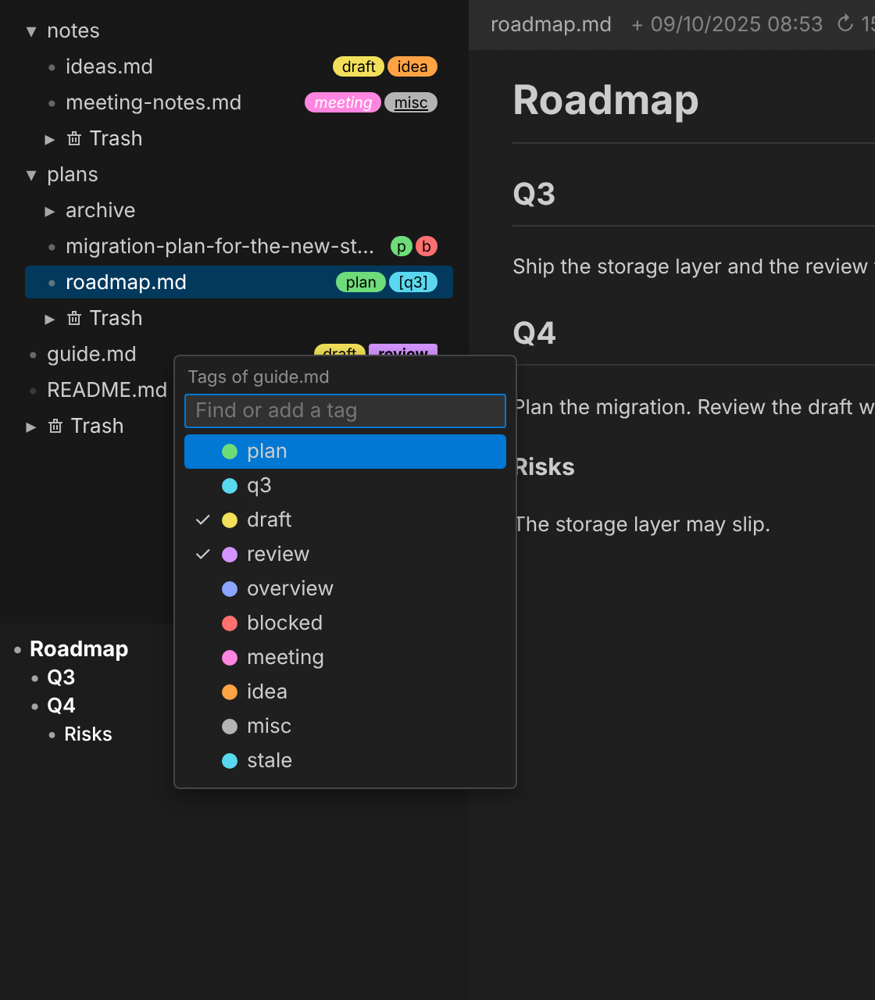

The tag picker lists every tag in tag order, with a check on the file's own. Type to
filter; a name no tag has yet is offered last, as a new tag. `Enter` toggles the
highlighted tag.

- Every tag has a colour from the panel's own palette, chosen so black text on it has a
  contrast ratio of at least 7:1. Tag colours do not change with the theme.
- Every tag has letters, unique among tags, used when a row is too narrow for the name:
  the first letter of each word, extended while another tag already uses them (`plan` is
  `p`, then `priority` is `pr`). They can be changed in the options.
- Styles per tag: bold, italic, underline, white text, square corners, and a pair of
  wrapping characters (`[]` draws `[plan]`).
- Tag order is set by dragging tags in the options. Every list of tags (tree, file bar,
  picker, search) uses it.

Clicking a tag in the tree opens the search with `tag:<name>`. With the search already
open it replaces the tag being searched for; with `Shift` held it is added to it.

Tags and colours are stored in `<docs folder>/.docs-panel.json`, so they are committed
with the documents. Each entry carries a content hash: a file moved or renamed outside the
panel keeps its tags and colour if its content matches exactly one entry; an ambiguous
match is dropped. A trashed file keeps its entry until it is deleted. The panel checks the
file's modification time every 1.5 s and reloads it when it changes, so edits from outside
(for example a `git pull`) show up in the tree.

## Tag buckets

**Tag buckets…** in a folder's menu (or a bucket's menu) selects which tags get a bucket
in that folder. Buckets are drawn at the top of the folder, each outlined in its tag's
colour. A file directly in the folder goes into the bucket of the first of its tags, in
bucket order, that has one; it is shown there without its tags. Pinned files come first.
Files with no matching bucket follow the buckets as usual.

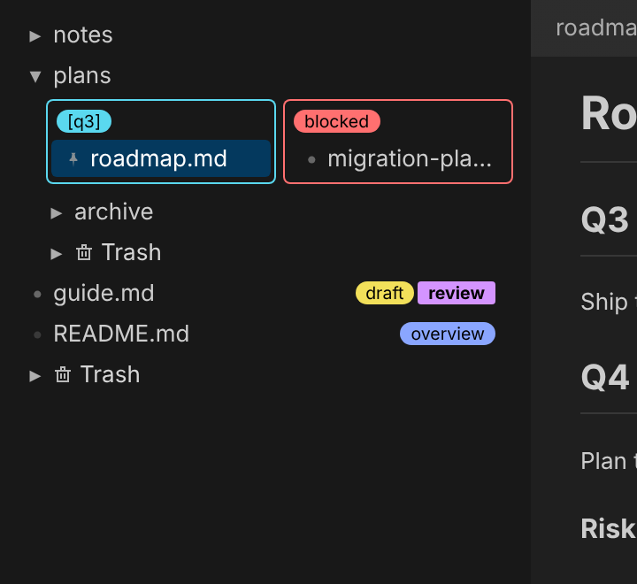

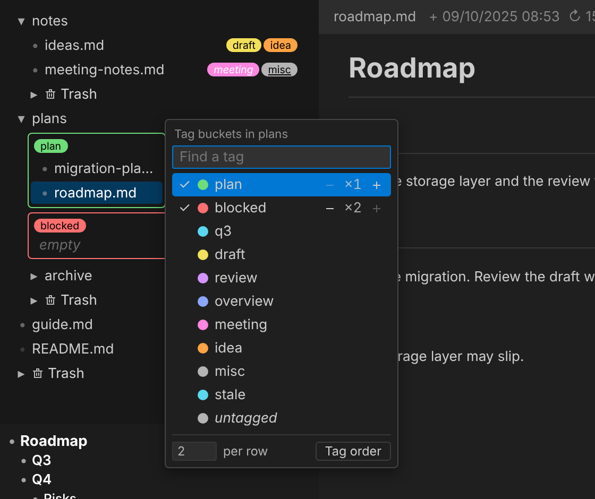

The picker also offers *untagged*, a bucket for the folder's files with no tags. It has no
colour, letters or style, but can be enabled, spanned and ordered like a tag's bucket.

| Drag a file | Effect |
|---|---|
| From one bucket to another | Removes the first bucket's tag, adds the second's |
| From a bucket to the folder's other files | Removes the bucket's tag |
| From the folder's other files to a bucket | Adds the bucket's tag |
| From another folder to a bucket | Moves the file into the folder and adds the bucket's tag |
| To the untagged bucket | Removes all the file's tags, moving it first if it is from another folder |

Layout, set in the picker:

- **−** / **+** next to a tag set how many columns its bucket spans.
- **per row** sets the number of columns. Columns have equal width; each row is as tall as
  its tallest bucket. `1` stacks the buckets vertically.
- Dragging a tag in the picker gives the folder its own bucket order. **Tag order**
  returns it to the global tag order.

Buckets and their layout are stored per folder and follow the folder when it is renamed or
moved. Outline, background tint, and heading position and style are set in the options.

## Search all docs

Open with the search button in the tree's top right corner (shown while the pointer is in
that corner), or by pressing `Ctrl+F` twice with `Ctrl` held.

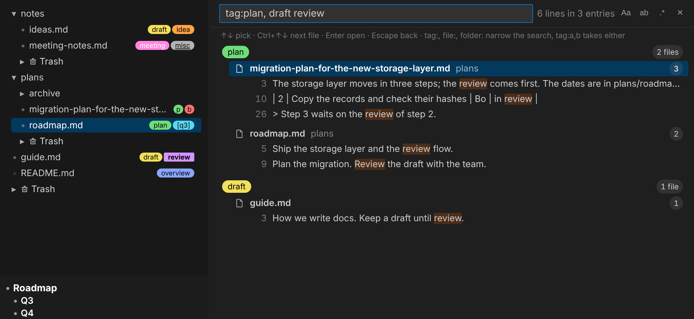

The search matches folder and file names and the text of every file (files over 2 MB and
binary files are skipped for text). Results are grouped by file, one line per match. A
file or folder whose name matches is listed even when its content does not.

A scope prefix limits the files searched:

| Search | Searches |
|---|---|
| `tag:plan storage` | Files with a tag whose name contains `plan`, grouped by tag |
| `file:road storage` | Files whose name contains `road` |
| `folder:plans storage` | Files in a folder whose name contains `plans`, grouped by folder |

- Several names are separated by commas, with or without spaces; a file matching any of
  them is included: `tag:plan, draft storage`. Empty names are ignored.
- A scope with no search text lists every file it includes.
- Quote a name that contains a space or comma: `tag:"to do"`.
- Match case, whole word and regular expression are toggles next to the input.

| Key | Action |
|---|---|
| `Up` / `Down` | Previous / next result |
| `Ctrl+Up` / `Ctrl+Down` | Previous / next file |
| `Enter` | Open the file at that line, or reveal the folder in the tree |
| `Escape` | Close the search and return to the file that was open |

## Mentions from Claude Code sessions

The panel reads the Claude Code session logs for the workspace
(`~/.claude/projects/<workspace path with every non-alphanumeric character replaced by ->/*.jsonl`)
and collects every file name written in a user or assistant message. Tool results,
meta entries and slash command wrappers are ignored. Each name is resolved against the
docs folder: the longest path suffix that matches a file wins, and a bare file name only
counts when exactly one file has it.

The open file's mentions are listed above the page, newest first, with the time since and
an excerpt (user messages and assistant messages are drawn differently). The number shown
before **Show more** is set in the options; `off` disables mentions. The top of the
overview screenshot above shows three.

Logs are only appended to, so each log is read from the offset where the last scan stopped,
and only when its size changed. Results are cached in `.vscode/docs-panel-mentions.json`;
the cache is rebuilt when the extension version changes.

## Options

The sliders button in the tree's top right corner opens the options.

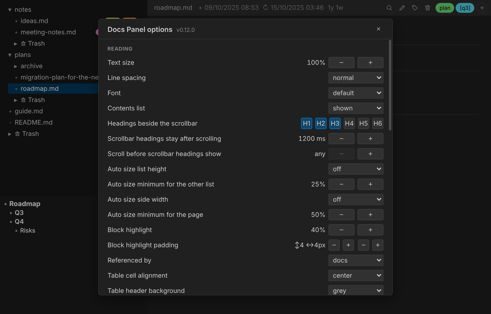

| Section | Settings |
|---|---|
| Reading | Text size, line spacing, font, contents list shown, heading levels shown beside the scrollbar (H1 to H6), how long they stay after scrolling (ms) and how far to scroll before they show (px), auto size list height and the minimum share kept by the other list, auto size side width (off / fit / grow only) and the minimum share kept by the page, block highlight strength and padding (vertical and horizontal), where referencing files are looked for (off / docs / all files), table cell alignment, table header background, mentions shown |
| Tree | Text size, side of the name the tags are drawn on, bucket outline, bucket background tint, bucket heading position (inside, on the outline, above), style (pill, colour bar, plain name), colour and weight |
| Tags | One row per tag; see below |
| Data files | Each file the panel writes, with its size and a **Purge** button |

Both auto size minimums go up to 75%.

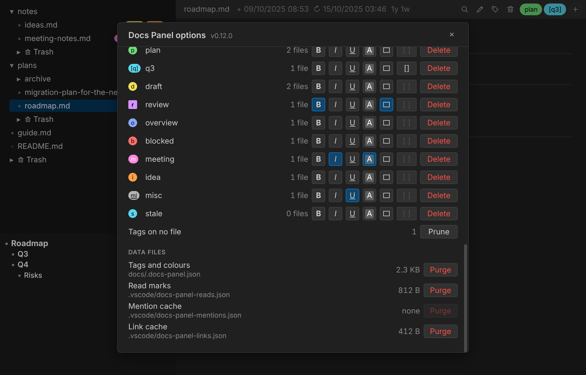

Each tag row has: its letters (click for a menu to change its colour or letters), its name
(click to rename), file count, style toggles (bold, italic, underline, white text, square
corners, wrapping characters), and **Delete**. Drag a row to reorder tags. **Prune**
removes tags that no file has; it is shown only when there are some, and hovering it marks
the tags it would remove.

## Settings

| Setting | Default | Meaning |
|---|---|---|
| `docsPanel.folder` | `docs` | Folder, relative to the workspace root, shown by the panel |
| `docsPanel.copyPrefix` | `{}` | Text put in front of the path copied by clicking the file name in the file bar, keyed by file extension without the dot. Trailing spaces are kept. Example: `{ "md": "/execute-plan " }` |

Both settings have resource scope, so a project can set them in `.vscode/settings.json`.

Everything set inside the panel (options, splits, buckets, pins, open folders, find
toggles, the selected file and scroll positions) is saved to
`.vscode/docs-panel-settings.json` shortly after each change and read back when the panel
opens: after closing the tab, in a new window, and after an update. It is the only copy:
deleting it, or **Purge** in the options' data files, resets them.

## Files the panel writes

| File | Contents | Purged effect |
|---|---|---|
| `<docs folder>/.docs-panel.json` | Tags, tag colours, letters, styles and order; file and folder colours | All tags and colours are lost |
| `.vscode/docs-panel-settings.json` | Panel settings and layout | Everything returns to defaults |
| `.vscode/docs-panel-reads.json` | Read marks | Every file is unread |
| `.vscode/docs-panel-mentions.json` | Mention cache | Rebuilt from the session logs on the next scan |
| `.vscode/docs-panel-links.json` | Which files each page's names resolve to, and which names outside the docs are workspace files (looked up again after 10 minutes) | Looked up again as pages are opened |
| `.vscode/docs-panel-refs.json` | The names and links each file holds, for **Referenced by** | Every file is read again when the next page is opened |

Only `.docs-panel.json` is meant to be committed; the others are per-user state.

## Source layout

| File | Role |
|---|---|
| `src/extension.ts` | Activation: registers the command and the webview serializer |
| `src/panel.ts` | The webview panel: state, messages to and from the page, file operations, timers |
| `src/tree.ts` | Walks the docs folder into the tree, including each folder's `.trash` |
| `src/watch.ts` | File system watcher with a 120 ms debounce, reporting tree and file changes |
| `src/render.ts` | Turns a file into page content by type; Markdown goes through `markdown.api.render` |
| `src/corpus.ts` | Text of every file for the search, re-read only when its modification time changes |
| `src/ledger.ts` | Tags, colours and read marks, keyed by path with content hashes |
| `src/links.ts` | Resolves file names in a page to docs or workspace files, with a cache |
| `src/refs.ts` | Finds the files that name a doc, for **Referenced by**, with a cache |
| `src/tables.ts` | Closes gaps in Markdown tables before rendering, and reorders a table's rows in the source |
| `src/mentions.ts` | Incremental scan of Claude Code session logs |
| `src/settings.ts` | Load and save `.vscode/docs-panel-settings.json` |
| `src/browser.ts` | Writes a standalone page for **Open in browser** |
| `media/main.js`, `media/main.css` | The webview: tree, page, menus, search, options |

The extension is bundled by esbuild (`esbuild.js`) into `dist/extension.js`. The webview
script and stylesheet are loaded as-is from `media/`.

## Development

```sh
npm install
npm run build        # bundle once
npm run watch        # bundle on change
npm run typecheck    # tsc --noEmit
npm run package      # build the .vsix
```

`.vscode/launch.json` has a **Run Extension** configuration that builds and starts an
Extension Development Host on `test-project/` (git-ignored; create it with a `docs`
folder to try the panel).

## Screenshots

`tools/screenshots` renders the panel's page in Chromium without VS Code, with a stand-in
for the extension host that serves a fixture docs folder. It takes a set of screenshots
of the working tree, or of a committed version and the working tree side by side; see
[its README](tools/screenshots/README.md).

The images in this README are its `readme.js` scenes:

```sh
node tools/screenshots/shots.js --scenes tools/screenshots/readme.js --out .github/readme
```

## Releasing

1. Raise the version: `npm version <x.y.z> --no-git-tag-version`.
2. Write the release notes to `.github/releases/v<x.y.z>.md`.
3. Merge to `master`.

The release workflow (`.github/workflows/release.yml`) runs on every push to `master`. If
the version in `package.json` has no release yet, it type-checks, builds the `.vsix`,
tags the commit and publishes the release with the notes file, or with notes generated
from the commits when there is no notes file.

## Limits

- Markdown is rendered by VS Code's built-in renderer, but scripts and styles that other
  extensions add to the Markdown preview (mermaid, KaTeX and similar) are removed, so
  their output is not drawn.
- Markdown links to files outside the docs folder do nothing. A workspace file named in
  the text, such as `src/panel.ts`, is a link.
- **Open in browser** works only for files on the local machine, not in a remote window.
